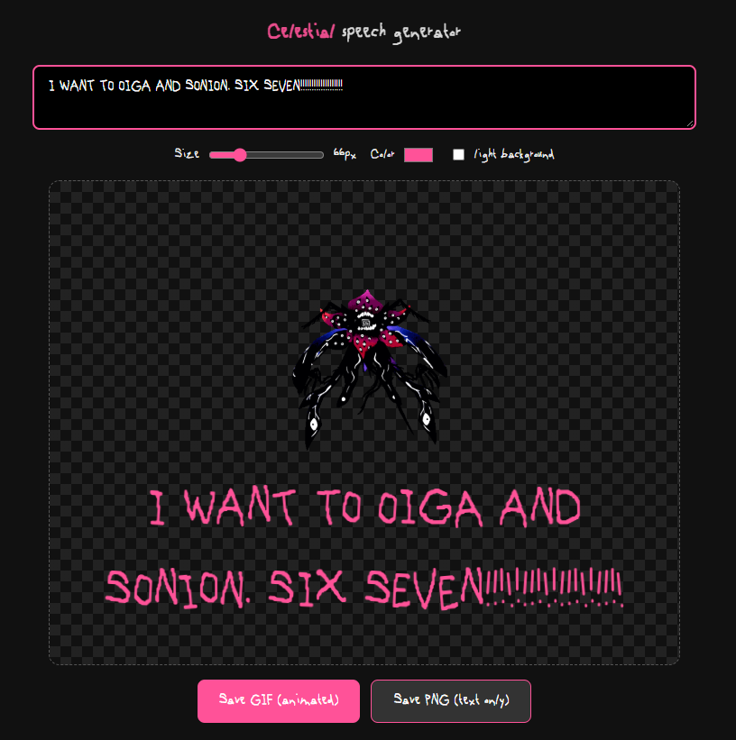

# [Celestial speech generator](https://muffler-2597.github.io/Celestial-speech-generator/)

글쎄요. 저도 이게 뭔지도 모르겠습니다. 영어 + 한글 지원합니다.

주의사항!!!!!!!!!!!!!!!!!!!이건엄청난AISLOP입니다여러분이걸학교프레젠테이션이나회사실적발표에사용하지마십시오

쓰인 에셋:
- 셀레스티얼 에셋 (로블록스 널스케이프 팀)
- 폰트 (오모리)

링크 : https://muffler-2597.github.io/Celestial-speech-generator/

---
## Credits / 출처 (법적 고지)

이 프로젝트는 비공식 팬 메이드이며 비상업적입니다. 아래 에셋의 권리는 각 권리자에게 있습니다.

- **OMORI GAME2 폰트** (`OMORI_GAME.woff`): OMORI풍 팬 제작 폰트, http://font.download 경유. OMORI © OMOCAT. 팬 사용.
- **나눔손글씨 암스테르담** (`NanumAmSeuTeReuDam.woff2`): 네이버 나눔글꼴 (SIL Open Font License 1.1). https://github.com/fonts-archive/NanumAmSeuTeReuDam
- **Celestial_Idle.gif**: Nullscape (Roblox) 게임 에셋. https://nullscape.wiki/The_Celestial — 권리는 Nullscape 팀에 있음. 팬 사용.
- **MartSlideAnimation.gif**: Nullscape (Roblox) 게임 에셋 — 권리는 Nullscape 팀에 있음. 팬 사용.
- **letter-sway 텍스트 효과**: nullscape.wiki의 Template:Boss/styles.css + MediaWiki:Common.js를 참고/이식.
- **omggif** (GIF 디코더): Dean McNamee, MIT License. https://github.com/deanm/omggif
- **gifenc** (GIF 인코더): Matt Desl, MIT License. https://github.com/mattdesl/gifenc
- **GolaCSS** (UI 스킨, CDN 연동): Muffler-2597 본인 프로젝트. https://github.com/Muffler-2597/GolaCSS

권리자분의 요청이 있으면 해당 에셋은 즉시 삭제합니다.
